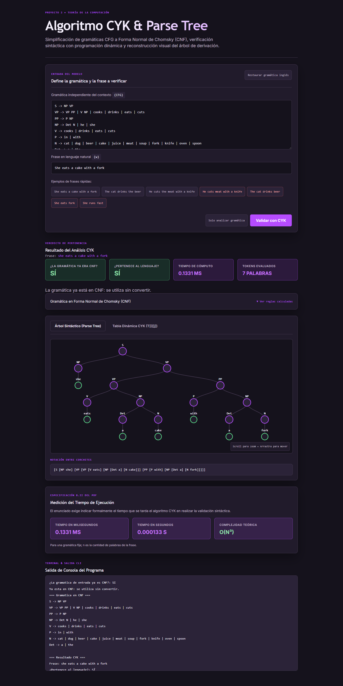
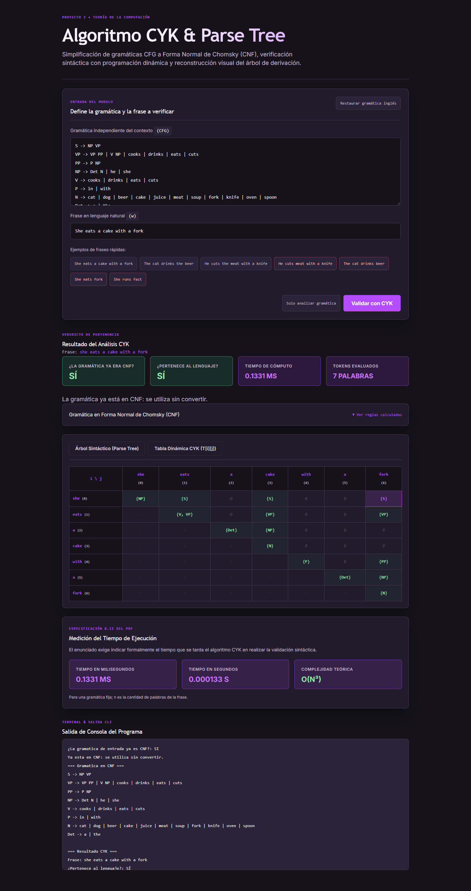
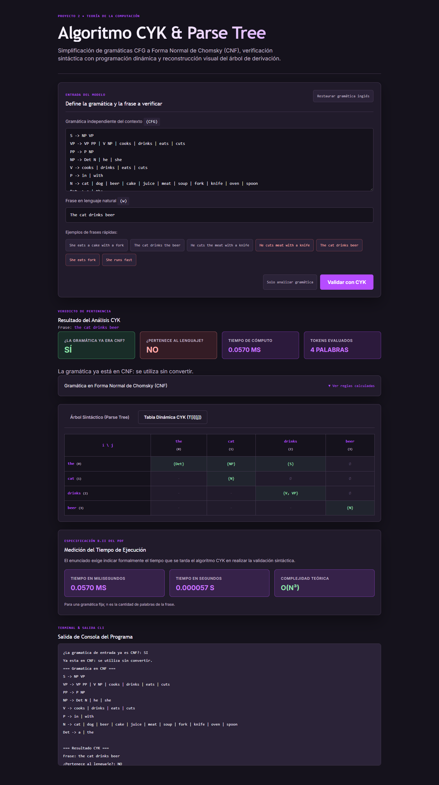
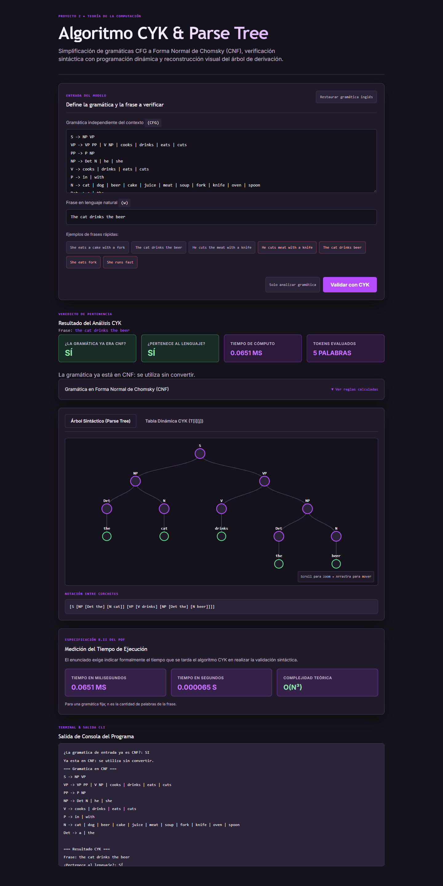

# Documentación y Reporte Técnico del Proyecto 2: Simplificación de Gramáticas y Algoritmo CYK

**Curso:** Teoría de la Computación  
**Ponderación:** 15 puntos netos  
**Enunciado:** Octubre, 2025

**Revisión de la implementación:** Octubre, 2026

---

## 1. Distribución de Roles y Responsabilidades del Equipo

El proyecto se organiza en tres áreas de responsabilidad que corresponden a la rúbrica:

### Integrante 1: Simplificación de Gramáticas y Conversión a CNF (7 Puntos)
* **Responsabilidad Principal:** Desarrollar el algoritmo que transforma cualquier gramática independiente del contexto (CFG) a la Forma Normal de Chomsky (CNF).
* **Módulos asignados:** `simplificacion_gramatica.py`, `cnf.py`, `parser_gramatica.py`, `tipos_gramatica.py`, `utils_gramatica.py`.
* **Tareas realizadas:**
  1. **Investigación:** Reglas de transformación formal a CNF según la teoría de autómatas y lenguajes formales.
  2. **Eliminación de producciones $\varepsilon$:** Algoritmo de detección de símbolos anulables (`simbolos_anulables`) y generación combinatoria de variantes (`eliminar_epsilon`).
  3. **Eliminación de producciones unitarias:** Cálculo de alcanzabilidad entre no terminales y sustitución directa (`eliminar_unitarias`).
  4. **Eliminación de símbolos inútiles:** Detección de símbolos generadores y símbolos alcanzables desde el símbolo inicial (`eliminar_inutiles`).
  5. **Binarización y variables terminales:** Sustitución de terminales en producciones compuestas y segmentación de producciones de longitud $> 2$ en pares binarios (`convertir_a_cnf`).
  6. **Pruebas de validación:** Verificación con `ejemplos/1.txt` contrastado contra `ejemplos/1-cnf.txt`.

### Integrante 2: Implementación del Algoritmo CYK (7 Puntos)
* **Responsabilidad Principal:** Implementar el algoritmo Cocke-Younger-Kasami (CYK) mediante programación dinámica para determinar la pertenencia de una frase al lenguaje generado por la gramática en CNF.
* **Módulos asignados:** `cyk.py` (motor de inferencia, indexación y programación dinámica).
* **Tareas realizadas:**
  1. **Investigación teórica:** Análisis de la programación dinámica y de la complejidad cúbica en la longitud de la frase para una gramática fija; la sección 3.3 detalla el costo de esta implementación.
  2. **Estructura de la tabla dinámica:** Diseño de la matriz triangular superior $T[i][j]$ para subcadenas desde la posición $i$ hasta $j$.
  3. **Pre-indexación de la gramática:** Creación de tablas hash para reglas unarias ($a \to \{A\}$) y binarias ($(B, C) \to \{A\}$) para accesos directos en $O(1)$.
  4. **Paso base (largo 1):** Inicialización de la diagonal principal con producciones terminales directas.
  5. **Paso recursivo (largos $2 \dots n$):** Evaluación de todos los cortes posibles $k \in [i, j-1]$, realizando el producto cartesiano entre subcadenas y emparejamiento con reglas binarias.
  6. **Decisión de aceptación:** Comprobación del símbolo inicial de la gramática CNF en la celda superior `T[0][n-1]`.

### Integrante 3: Integración, Árbol Sintáctico, Frontend React y Documentación (1 Punto + Integración)
* **Responsabilidad Principal:** Completar las funcionalidades de salida exigidas, unificar las ramas de desarrollo, construir el frontend en React con D3.js, containerizar con Docker y estructurar la documentación técnica.
* **Módulos asignados:** `cyk.py` (parse tree), `main.py` (CLI), `frontend/` (React + CSS + D3.js), `Dockerfile`, `docker-compose.yml`, `app.py` y `DOCUMENTACION.md`.
* **Tareas realizadas:**
  1. **Almacenamiento de antecedentes (*back-pointers*):** Registro estructurado de la procedencia de cada derivación (`("term", w)` y `("bin", k, B, C)`).
  2. **Reconstrucción del Parse Tree:** Implementación del recorrido recursivo `construir_arbol` y generador de árbol jerárquico (`formatear_arbol_texto` y `arbol_a_parentesis`).
  3. **Medición de tiempos:** Uso de `time.perf_counter()` y presentación del tiempo medido en milisegundos y segundos.
  4. **Salida estricta SÍ / NO:** Validación conforme a especificación.
  5. **Frontend Moderno en React con D3.js:** Creación de una SPA reactiva con zoom interactivo, navegación por pestañas y visualización de la tabla dinámica de programación dinámica.
  6. **Containerización Docker:** Despliegue en un solo comando mediante `docker compose up --build`.
  7. **Documentación del proyecto:** Redacción técnica completa, diseño de software, análisis pedagógico paso a paso y recopilación de evidencias con screenshots.

---

## 2. Diseño de la Aplicación

### 2.1 Diagrama de Arquitectura del Sistema
El sistema implementa una arquitectura modular desacoplada entre el motor formal y la capa visual:

```
┌────────────────────────────────────────────────────────┐
│               CAPA DE ENTRADA Y PARSING                 │
│  • parser_gramatica.py (Lee reglas CFG)                 │
│  • tipos_gramatica.py / utils_gramatica.py             │
└──────────────────────────┬─────────────────────────────┘
                           │
                           ▼
┌────────────────────────────────────────────────────────┐
│             CAPA DE SIMPLIFICACIÓN A CNF               │
│  • simplificacion_gramatica.py                         │
│    - eliminar_epsilon()                                │
│    - eliminar_unitarias()                              │
│    - eliminar_inutiles()                               │
│  • cnf.py (Binarización y normalización CNF)           │
└──────────────────────────┬─────────────────────────────┘
                           │  Gramática en CNF + símbolo inicial
                           ▼
┌────────────────────────────────────────────────────────┐
│             MOTOR DE INFERENCIA CYK & TREE             │
│  • cyk.py                                              │
│    - indexar_gramatica() [O(1) unarias / binarias]     │
│    - cyk() [Tabla DP T[i][j] con back-pointers]        │
│    - construir_arbol() [Recorrido recursivo del árbol] │
│    - arbol_a_parentesis() / formatear_arbol_texto()    │
└──────────────────────────┬─────────────────────────────┘
                           │
             ┌─────────────┴─────────────┐
             ▼                           ▼
┌─────────────────────────┐ ┌─────────────────────────┐
│     LÍNEA DE COMANDOS   │ │     FRONTEND REACT      │
│        (main.py)        │ │    (SPA con D3.js)      │
│  • SÍ / NO              │ │  • Árbol SVG interactivo│
│  • Tiempo en ms         │ │  • Matriz triangular DP │
│  • Árbol ASCII          │ │  • Docker Compose       │
└─────────────────────────┘ └─────────────────────────┘
```

---

## 3. Fundamento Teórico y Funcionamiento del Algoritmo CYK

### 3.1 ¿Qué problema resuelve el algoritmo CYK?
Dada una gramática libre de contexto en Forma Normal de Chomsky (CNF) y una frase $w$ compuesta por $n$ palabras ($w = w_0\, w_1 \dots w_{n-1}$), el algoritmo responde: **¿puede la gramática generar esta frase?**

Para resolverlo, utiliza **programación dinámica**:
1. Resuelve primero los subproblemas elementales (las palabras sueltas, longitud 1).
2. Guarda los resultados en una tabla estructurada.
3. Con dichas soluciones, construye problemas progresivamente mayores (subcadenas de 2 palabras, luego 3, ..., hasta las $n$ palabras de la frase completa).
4. **Principio fundamental:** Cada celda se calcula una vez, combinando todos sus cortes y reutilizando las celdas de segmentos más cortos. Esta organización sigue el esquema descrito en [OpenDSA: CYK Parsing](https://opendsa-server.cs.vt.edu/OpenDSA/Books/PIFLA/html/CYKParsing.html).

### 3.2 ¿Por qué se exige la Forma Normal de Chomsky (CNF)?
En CNF, cualquier derivación de una subcadena de 2 o más palabras proviene **estrictamente** de una regla de la forma:
$$A \to B\,C$$
Esto garantiza que cualquier segmento sintáctico de tamaño $L \ge 2$ se compone de la concatenación exacta de **dos pedazos no vacíos**. Gracias a esto, el algoritmo solo necesita evaluar particiones binarias (un único punto de corte $k$).

También se permiten reglas terminales `A -> palabra`. La implementación admite la
extensión `S -> ε` únicamente si el inicial no aparece en ningún lado derecho.
La frase vacía se resuelve por separado. La gramática inglesa del enunciado ya está
en CNF: se conserva su inicial `S` y no se convierte. Para otras gramáticas se valida
primero la entrada, se convierte solo si hace falta y se verifica el resultado.

### 3.3 Recurrencia, complejidad y medición

En la diagonal, `T[i][i]` contiene cada `A` con una regla `A -> w[i]`.
Para `i < j`, se agrega `A` cuando existe `A -> B C` y algún corte `k` con
`B` en `T[i][k]` y `C` en `T[k+1][j]`. La aceptación se decide comprobando
el inicial en `T[0][n-1]`, como describe [OpenDSA](https://opendsa-server.cs.vt.edu/OpenDSA/Books/PIFLA/html/CYKParsing.html).

Con una gramática fija, el tiempo es `O(n³)` y la tabla ocupa `O(n²)`.
Si se incluye el tamaño de la gramática, esta implementación indexa las reglas y recorre
los pares de variables de las celdas: una cota es
`O(|P| + n|V| + n³(|V|² + |P₂|))`, donde `P₂` son las reglas binarias.
Ordenar las variables añade `O(n³ |V| log |V|)`, absorbido por la cota anterior.
La memoria de la tabla es `O(n² |V|)` más los índices de la gramática.

El reloj `time.perf_counter()` rodea exclusivamente la llamada a `cyk`, incluida
su indexación. No incluye lectura, conversión a CNF, reconstrucción del árbol,
serialización ni dibujo. Los tiempos se muestran en milisegundos y segundos y
varían con el equipo y la ejecución; no constituyen una medida exacta e invariable.

---

## 4. Ejemplo Teórico Paso a Paso

### 4.1 Gramática de Ejemplo y Frase
Sea la gramática formal:
$$\begin{aligned}
S &\to A\,B \mid B\,C \\
A &\to B\,A \mid a \\
B &\to C\,C \mid b \\
C &\to A\,B \mid a
\end{aligned}$$

Cadena de prueba:
$$w = b\ a\ a\ b\ a \quad (n = 5 \text{ palabras})$$

| Posición ($i$) | 0 | 1 | 2 | 3 | 4 |
| :---: | :---: | :---: | :---: | :---: | :---: |
| **Palabra** | `b` | `a` | `a` | `b` | `a` |

---

### 4.2 La Tabla de Programación Dinámica (La Escalera Triangular)
Cada celda $[i, j]$ representa la subcadena que comienza en la palabra $i$ y termina en la palabra $j$.

```text
largo 5 │ [0,4]
largo 4 │ [0,3]  [1,4]
largo 3 │ [0,2]  [1,3]  [2,4]
largo 2 │ [0,1]  [1,2]  [2,3]  [3,4]
largo 1 │ [0,0]  [1,1]  [2,2]  [3,3]  [4,4]
           b      a      a      b      a
```

* **Fila:** Representa la longitud $L$ de la subcadena.
* **Columna:** Subcadenas que inician en la palabra $i$.
* **Almacenamiento en código:** Matriz `T[i][j]` de $n \times n$. Solo se emplea el triángulo superior ($j \ge i$), ya que una subcadena no puede terminar antes de empezar.

---

### 4.3 Concepto de Corte ($k$)
Para analizar una subcadena $[i, j]$ de longitud $L \ge 2$, se deben probar todas las formas posibles de partirla en dos fragmentos contiguos no vacíos:
* **Fragmento izquierdo:** $[i, k]$
* **Fragmento derecho:** $[k+1, j]$

El índice de corte $k$ recorre el intervalo $[i, j-1]$ (en código Python: `range(i, j)`).  
Una subcadena de longitud $L$ tiene exactamente $L - 1$ cortes posibles.

**Ejemplo de cortes para la celda $[1, 4]$ ($«a\ a\ b\ a»$):**
1. $k = 1$: Izquierda $[1, 1] = «a»$ | Derecha $[2, 4] = «a\ b\ a»$
2. $k = 2$: Izquierda $[1, 2] = «a\ a»$ | Derecha $[3, 4] = «b\ a»$
3. $k = 3$: Izquierda $[1, 3] = «a\ a\ b»$ | Derecha $[4, 4] = «a»$

---

### 4.4 Ejecución Paso a Paso sobre «baaba»

#### Paso 1: Largo 1 (Inicialización)
* $[0, 0]$ (`b`) $\implies \{B\}$
* $[1, 1]$ (`a`) $\implies \{A, C\}$
* $[2, 2]$ (`a`) $\implies \{A, C\}$
* $[3, 3]$ (`b`) $\implies \{B\}$
* $[4, 4]$ (`a`) $\implies \{A, C\}$

#### Paso 2: Largo 2 (1 corte por celda)
* $[0, 1]$ (`ba`, $k=0$): $[0,0]\{B\} \times [1,1]\{A,C\} \implies BA \to A,\; BC \to S \implies \mathbf{\{A, S\}}$
* $[1, 2]$ (`aa`, $k=1$): $[1,1]\{A,C\} \times [2,2]\{A,C\} \implies CC \to B \implies \mathbf{\{B\}}$
* $[2, 3]$ (`ab`, $k=2$): $[2,2]\{A,C\} \times [3,3]\{B\} \implies AB \to S, C \implies \mathbf{\{S, C\}}$
* $[3, 4]$ (`ba`, $k=3$): $[3,3]\{B\} \times [4,4]\{A,C\} \implies BA \to A,\; BC \to S \implies \mathbf{\{A, S\}}$

#### Paso 3: Largo 3 (2 cortes por celda)
* $[0, 2]$ (`baa`): $\mathbf{\emptyset}$
* $[1, 3]$ (`aab`): $\mathbf{\{B\}}$
* $[2, 4]$ (`aba`): $\mathbf{\{B\}}$

#### Paso 4: Largo 4 (3 cortes por celda)
* $[0, 3]$ (`baab`): $\mathbf{\emptyset}$
* $[1, 4]$ (`aaba`): $\mathbf{\{S, C, A\}}$

#### Paso 5: Largo 5 (Frase Completa $[0, 4]$, 4 cortes)
* $k=0$: $[0,0]\{B\} \times [1,4]\{S,C,A\} \implies BC \to S,\; BA \to A \implies \mathbf{\{S, A\}}$
* $k=1$: $[0,1]\{A,S\} \times [2,4]\{B\} \implies AB \to S,C \implies \mathbf{\{S,C\}}$
* **Resultado Celda Final $[0, 4]$:** $\mathbf{\{S, A, C\}}$

**Veredicto:** Como el símbolo inicial $S \in T[0][4]$, la frase **SÍ** pertenece al lenguaje.

---

## 5. Caso de Estudio: Gramática en Inglés y Parse Tree

### 5.1 Gramática en CNF
```text
S   -> NP VP
VP  -> VP PP | V NP | cooks | drinks | eats | cuts
PP  -> P NP
NP  -> Det N | he | she
V   -> cooks | drinks | eats | cuts
P   -> in | with
N   -> cat | dog | beer | cake | juice | meat | soup | fork | knife | oven | spoon
Det -> a | the
```

### 5.2 Reconstrucción del Parse Tree mediante Back-Pointers
Al registrar las decisiones en cada celda, la función recursiva desciende generando el siguiente árbol:
```text
S
+-- NP
|   \-- she
\-- VP
    +-- VP
    |   +-- V
    |   |   \-- eats
    |   \-- NP
    |       +-- Det
    |       |   \-- a
    |       \-- N
    |           \-- cake
    \-- PP
        +-- P
        |   \-- with
        \-- NP
            +-- Det
            |   \-- a
            \-- N
                \-- fork
```
**Notación Jerárquica entre Corchetes:**  
`[S [NP she] [VP [VP [V eats] [NP [Det a] [N cake]]] [PP [P with] [NP [Det a] [N fork]]]]]`

El árbol se reconstruye desde el inicial con punteros `("term", palabra)` o
`("bin", corte, B, C)`. Se recorren cortes y variables en orden estable y se
guarda la primera derivación encontrada por variable y celda. Así se obtiene
un árbol reproducible; no se enumeran todos los árboles de gramáticas ambiguas.
Cuando se necesita conversión, el árbol corresponde a la gramática CNF y puede
contener auxiliares. Para ε se construye un inicial con una hoja `ε`.

---

## 6. Ejemplos, Pruebas Realizadas y Capturas de Pantalla

A continuación se presentan capturas reproducibles de la interfaz. Se actualizan con
`node tests/browser.mjs --capturas`, que comprueba los resultados antes de guardarlas.
Los tiempos visibles pertenecen a esa ejecución y pueden variar en otra máquina.

### 6.1 Prueba 1: Frase Aceptada con Árbol Sintáctico Interactivo
* **Frase:** `She eats a cake with a fork`
* **Veredicto:** **SÍ (Aceptada)**
* **Tiempo:** medido en la consola y en los indicadores de la captura.



---

### 6.2 Prueba 2: Tabla de Programación Dinámica CYK ($T[i][j]$)
Muestra la matriz triangular donde cada celda almacena el conjunto de variables sintácticas generadoras y la celda superior derecha confirma la presencia de `S`.



---

### 6.3 Prueba 3: Frase Rechazada (Sintaxis Inválida)
* **Frase:** `The cat drinks beer`
* **Veredicto:** **NO (Rechazada)**
* **Tiempo:** medido en la consola y en los indicadores de la captura.
* **Motivo:** En esta gramática, `beer` es sustantivo `N`, pero la regla sintáctica para objeto directo exige `NP -> Det N`, por lo que la ausencia de `the` o `a` invalida la frase.



---

### 6.4 Prueba 4: Segunda Frase Aceptada
* **Frase:** `The cat drinks the beer`
* **Veredicto:** **SÍ (Aceptada)**
* **Tiempo:** medido en la consola y en los indicadores de la captura.



---

### 6.5 Tabla Comparativa de Pruebas

| Frase evaluada | Veredicto | Diagnóstico sintáctico |
| :--- | :---: | :--- |
| `She eats a cake with a fork` | **SÍ** | Sujeto, verbo, objeto y sintagma preposicional. |
| `The cat drinks the beer` | **SÍ** | Sujeto y objeto con determinante. |
| `He cuts the meat with a knife` | **SÍ** | Pronombre sujeto y objeto con determinante. |
| `She cooks` | **SÍ** | Se permite `VP -> cooks` sin objeto. |
| `The fork eats the dog` | **SÍ** | Sintaxis válida, aunque su significado resulte extraño. |
| `He cuts meat with a knife` | **NO** | Falta determinante antes de `meat`. |
| `The cat drinks beer` | **NO** | Falta determinante en el objeto. |
| `She eats fork` | **NO** | Falta determinante antes de `fork`. |
| `She runs fast` | **NO** | Vocabulario fuera de la gramática. |
| Cadena vacía | **NO** | La gramática inglesa no genera ε. |

Estas frases están verificadas por `test_frases_ingles_y_reglas_de_cada_arbol`.
La aplicación normaliza a minúsculas solo los tokens que no coinciden exactamente
con un terminal. Se separa por espacios y no se elimina puntuación: `cake.` es
distinto de `cake`. La corrección se refiere al lenguaje formal, no al inglés general.

---

## 7. Discusión, Obstáculos Encontrados y Recomendaciones

### 7.1 Obstáculos Encontrados
1. **Distinción entre reglas unitarias y terminales:**
   `A -> B` es unitaria si `B` es no terminal; `VP -> eats` es terminal y debe conservarse.
   La simplificación calcula el cierre de reglas unitarias, incluidos ciclos, y conserva
   las reglas terminales. CYK permite que una misma palabra tenga varios generadores,
   como `V` y `VP` para `eats`.
2. **Reconstrucción Determinista del Árbol Sintáctico:**  
   Cuando existen múltiples particiones válidas para una misma subcadena, representar
   todos los árboles puede requerir espacio exponencial. Se conserva una derivación
   por variable y celda, usando cortes crecientes y variables ordenadas. El árbol
   resultante tiene `O(n)` nodos para frases no vacías. La tabla completa conserva
   su costo de memoria `O(n² |V|)`; no debe confundirse con el tamaño del árbol.
3. **Containerización y Despliegue de React sin Servidores Externos:**  
   Para evitar obligar al usuario a correr `npm run dev` y `python app.py` en consolas separadas, se diseñó un `Dockerfile` multi-stage: Node.js compila el bundle estático de Vite y Python lo sirve junto a la API REST en el puerto `5000`.
4. **Colisiones de nombres al convertir a CNF:**
   Un terminal puede llamarse `S0`, `T_A` o `BIN_1`. Los auxiliares se reservan contra
   todos los símbolos de la gramática original y los auxiliares ya creados; así no
   convierten accidentalmente un terminal en variable. Las pruebas incluyen estos casos.
5. **Conservación del lenguaje al exportar:**
   El símbolo inicial se escribe primero al guardar. Un símbolo sin producciones se
   representa como `S -> ∅`, mientras `S -> ε` genera la cadena vacía. Esto evita
   cambiar el lenguaje al volver a cargar una gramática guardada.

### 7.2 Recomendaciones
* Para gramáticas ambiguas más complejas del procesamiento del lenguaje natural (NLP), se recomienda evolucionar a **Probabilistic CYK (PCYK)** con pesos de probabilidad en cada producción.
* Usar el árbol dibujado con D3.js y la tabla para explicar cómo las celdas más cortas permiten construir las más largas.
* Al modificar la gramática, ejecutar las pruebas; comprobar solo que el resultado tenga forma CNF no demuestra que conserve el lenguaje.
* Si se necesitan todos los análisis de una frase ambigua, ampliar los back-pointers a un bosque compartido. El requisito actual pide un parse tree.

---

## 8. Instrucciones de Ejecución con Docker

Para levantar toda la aplicación (Backend + Frontend React) en un solo comando:

```bash
docker compose up --build -d
```
Luego abre tu navegador en:  
**[http://localhost:5000](http://localhost:5000)**

Para detener el contenedor:
```bash
docker compose down
```

Para ejecutar sin Docker, instala Python 3.10+ y Node.js 22.12+, y desde la raíz:

```bash
npm --prefix frontend ci
npm --prefix frontend run build
python app.py
```

Para probar únicamente la entrada de frases por consola, la gramática inglesa se carga
por defecto y no requiere instalar Node:

```bash
python main.py -f "She eats a cake with a fork"
python main.py -f "The cat drinks the beer"
python main.py
```

El último comando solicita solo la frase por teclado. Para otras gramáticas y para el
modo sin frases:

```bash
python main.py ejemplos/1.txt -f "id + id"
python main.py ejemplos/1.txt --solo-gramatica -o salida-cnf.txt
python main.py ejemplos/1-cnf.txt --solo-gramatica
```

## 9. Simplificación Completa Paso a Paso

El archivo reproducible [ejemplos/simplificacion.txt](ejemplos/simplificacion.txt) incluye:

```text
S -> A B C | U
A -> a | ε
B -> b
C -> c
U -> V
V -> d
X -> x
Y -> Y
```

Su lenguaje es `{a b c, b c, d}`. Los espacios separan terminales; `a b c` tiene tres
tokens. El procedimiento general de eliminación y factorización puede consultarse en
[Old Dominion University: Converting to CNF](https://www.cs.odu.edu/~zeil/cs390/s25-live/Public/cfreeLang-rec/index.html).

**1. Nuevo inicial y eliminación de ε.** Se agrega `S0 -> S`. `A` es anulable,
por lo que se agrega la variante `S -> B C` y se elimina `A -> ε`:

```text
S0 -> S
S -> A B C | B C | U
A -> a
B -> b
C -> c
U -> V
V -> d
X -> x
Y -> Y
```

**2. Eliminación de unitarias.** El cierre incluye `S0 -> S -> U -> V`, de donde se
obtienen las alternativas terminales y no unitarias:

```text
S0 -> A B C | B C | d
S -> A B C | B C | d
A -> a
B -> b
C -> c
U -> d
V -> d
X -> x
Y -> ∅
```

`∅` indica ausencia de producciones. No se introduce una derivación de ε.

**3. Eliminación de inútiles.** Se eliminan variables no generadoras y luego las
inalcanzables desde `S0`. Desaparecen `Y` y las variables `S`, `U`, `V`, `X`:

```text
S0 -> A B C | B C | d
A -> a
B -> b
C -> c
```

**4. Separación de terminales y binarización.** En este caso no hay terminales dentro
de reglas compuestas. Se factoriza la regla de longitud tres:

```text
S0 -> A BIN_1 | B C | d
A -> a
B -> b
C -> c
BIN_1 -> B C
```

El resultado cumple CNF y acepta exactamente las tres cadenas originales. Para una
regla mixta como `S -> a B`, el conversor introduce `T_A -> a` y sustituye la regla
por `S -> T_A B`, eligiendo otro nombre si `T_A` ya existe.

La conservación de ε se prueba por separado con `S -> A B`, `A -> a | ε`,
`B -> b | ε`: antes y después de convertir se aceptan `ε`, `a`, `b` y `a b`.
Si el lenguaje original es vacío, por ejemplo `S -> A`, `A -> A`, el resultado
es un inicial sin producciones y se rechazan todas las frases, incluida ε.

## 10. Verificación y Correspondencia con el Enunciado

Desde la raíz del proyecto:

```bash
python -m unittest discover -s tests -v
npm --prefix frontend run lint
npm --prefix frontend run build
node tests/browser.mjs
```

La prueba del navegador necesita Chrome o Edge y Node.js; utiliza el protocolo de
depuración del navegador y no necesita paquetes adicionales. Arranca y detiene su
propio servidor en un puerto libre. Se puede indicar `BROWSER_PATH`, `PYTHON` o
`BASE_URL` para personalizar los ejecutables o probar un servidor ya iniciado.

| Área | Evidencia reproducible |
| --- | --- |
| Simplificación (7 puntos) | `tests/test_algoritmos.py`: anulables transitivos, ε repetido, ciclos unitarios, no generadores, inalcanzables, reglas largas y colisiones de nombres. |
| Conservación del lenguaje | 100 gramáticas generadas con semilla fija y 15 cadenas por gramática, comparadas con un reconocedor CFG independiente por cierre de intervalos: 1,500 comparaciones. Es una comprobación acotada, no una demostración formal para toda CFG. |
| CYK (7 puntos) | Inicialización, composición y aceptación; frases de la sección 6; comprobación de cada regla y de las hojas de los árboles. |
| Entrada a.i | Gramática inglesa precargada en web y CLI; basta ingresar la frase. |
| Ejemplos a.ii | Tabla de frases aceptadas y rechazadas de la sección 6.5. |
| Salidas b.i y b.ii | SÍ/NO y tiempo de la llamada CYK en consola y web. |
| Árbol b.iii | Back-pointers, árbol de ε y selección estable bajo distintas semillas de hash. |
| Integración | `tests/test_validacion.py`, `tests/test_http.py` y `tests/browser.mjs`: API, CLI, HTTP y flujos reales de interfaz. |
| Documentación (1 punto) | Diseño: sección 2; fundamentos: 3–5; ejemplos y pruebas: 6, 9 y 10; discusión: 7. |

Al validar solo una gramática, las pruebas comprueban que no se llama a CYK. Si ya es
CNF, comprueban que no se invoca la conversión y que se conserva su inicial.
Las pruebas de exportación vuelven a leer el archivo y comparan su lenguaje.
El enunciado no exige analizar el significado de la frase ni enumerar todos los árboles.

Resultado de la verificación de esta revisión:

* 24 pruebas de Python aprobadas, incluidas las 1,500 comparaciones del lenguaje.
* Compilación de Vite y análisis de Oxlint completados sin errores ni advertencias.
* Prueba de interfaz aprobada en Chrome: frases, árbol, tabla, validación sin frases,
  conversión condicional, errores y ε.
* Imagen Docker construida con instalación limpia de dependencias mediante `npm ci`;
  la misma prueba de navegador aprobada contra el contenedor.
* Cuatro capturas regeneradas desde la aplicación y configuración de Compose validada.

## 11. Referencias

* Enunciado de **Proyecto 2, Teoría de la Computación, octubre de 2025**, proporcionado para esta entrega: requisitos, gramática inglesa y rúbrica 7 + 7 + 1.
* OpenDSA, Virginia Tech. [CYK Parsing](https://opendsa-server.cs.vt.edu/OpenDSA/Books/PIFLA/html/CYKParsing.html). Programación dinámica, tabla, reglas CNF y criterio de aceptación.
* CS390, Old Dominion University. [Properties of Context-Free Languages — Examples](https://www.cs.odu.edu/~zeil/cs390/s25-live/Public/cfreeLang-rec/index.html). Ejemplos de eliminación de ε, unitarias, símbolos inútiles y factorización a CNF. Esta implementación conserva ε mediante un inicial nuevo cuando pertenece al lenguaje original.
